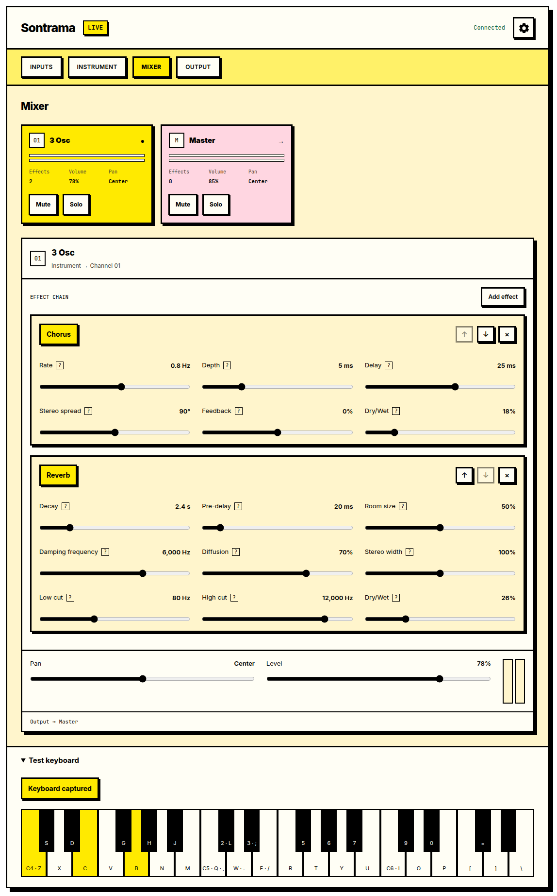
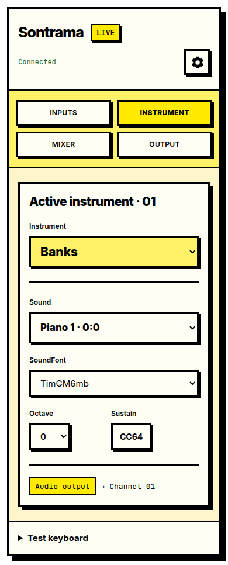
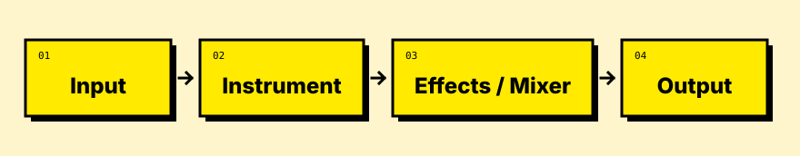
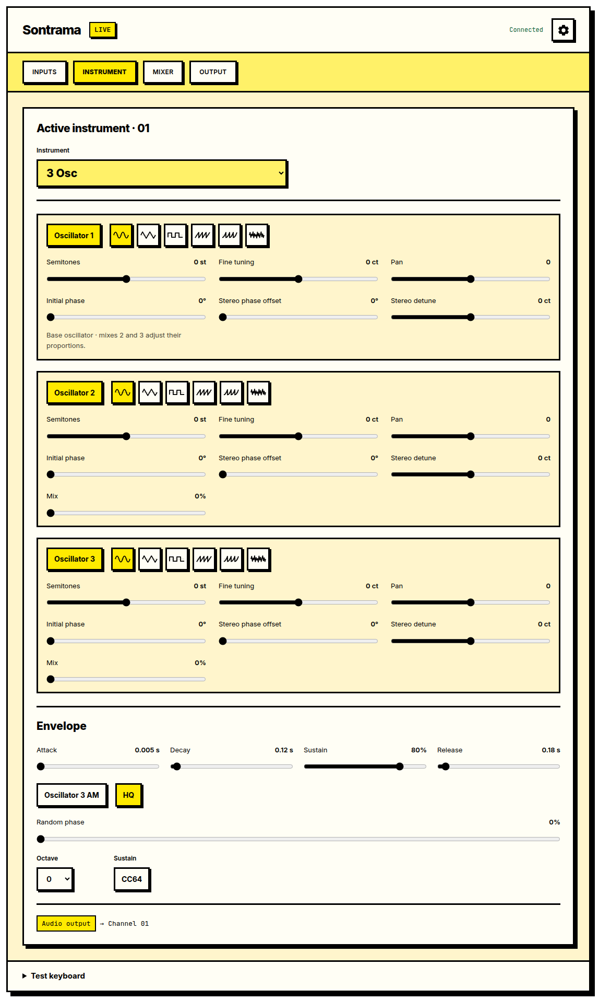
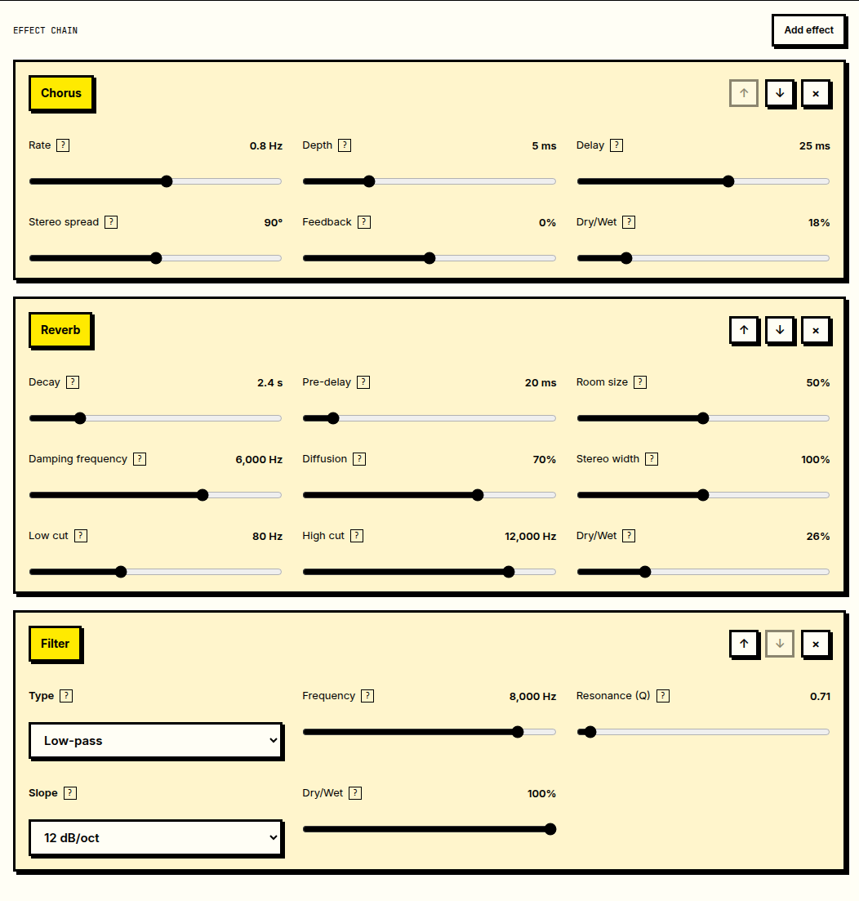
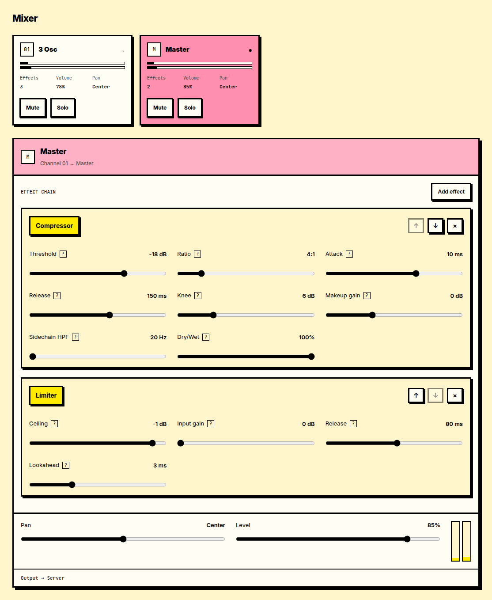
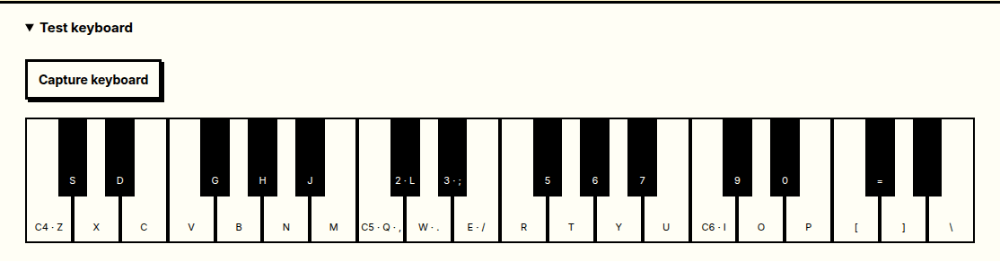

<p align="center">
  
</p>

<p align="center">
  <strong>Plug in. Pick a sound. Play.</strong><br>
  Turn a Raspberry Pi and a USB MIDI keyboard into a live synth.<br>
  Control it from your browser. Keep playing when the browser closes.
</p>

<p align="center">
  <a href="sontrama/README.md#running-locally">Get started</a> ·
  <a href="docs/DEVELOPMENT.md">Build &amp; deploy</a> ·
  <a href="LICENSE">MIT licensed</a>
</p>

<table>
  <tr>
    <td width="74%"></td>
    <td width="26%"></td>
  </tr>
</table>

<p align="center"><sub>A snapshot of the current desktop and mobile interface.</sub></p>

## Four stages. One clear path.

<p align="center">
  
</p>

Bring in MIDI, choose an instrument, shape its sound and send it out.
Each part has its own job; instruments and effects plug into shared contracts.

- **Interchangeable instruments:** choose a sound engine while keeping the same MIDI controls and signal path.
- **Build an effect chain:** add, bypass and reorder effects; balance the sound with channel and master controls.
- **Try it anywhere:** play the on-screen or PC keyboard with browser audio preview. Incoming MIDI lights up the keys.
- **Ready for the small box:** Linux audio output, automatic USB MIDI connection and systemd startup. Tested on Raspberry Pi 3 B.

## Take a look

For example, play SF2 SoundFonts with **Banks**, or build a sound with **3 Osc**.
Add chorus for movement, reverb for space, or shape the result with gain and filtering.
Control dynamics with a compressor and tame peaks with a limiter.
See the [application guide](sontrama/README.md) for capabilities and requirements.

### Inside 3 Osc



### Shape and balance

Select a channel or Master, shape its effect chain, then adjust its level and pan.

<table>
  <tr>
    <td width="50%" valign="top"></td>
    <td width="50%" valign="top"></td>
  </tr>
</table>

### MIDI in motion

Incoming MIDI lights up the keyboard, even with browser preview off.
Here is C → G → Am → F:

<p align="center">
  
</p>

## Get playing

After installing the [system dependencies](sontrama/README.md#running-locally):

```sh
cd sontrama
uv sync --frozen && npm ci && npm run build
uv run --frozen sontrama
```

Open **http://localhost:8081**. Enable **Browser preview** in **Output** to listen in your browser.

Each browser generates its own preview audio, independently of the server output.
The preview switch is shared across connected screens.

[Setup & instruments](sontrama/README.md) · [Development & deployment](docs/DEVELOPMENT.md) · [MIT License](LICENSE)
